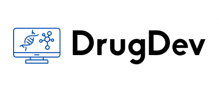

# DrugDev

A Streamlit toolkit for early-stage drug discovery, focused on neurological disease. It combines
an ML solubility predictor, a filterable catalog of FDA-approved drugs, a virtual formulation
lab, and a live research news feed.



## Features

| Page | What it does |
|---|---|
| **Solubility Predictor** | Takes SMILES strings, computes RDKit descriptors (LogP, molecular weight, rotatable bonds, aromatic proportion), and predicts aqueous solubility (LogS) with a trained scikit-learn linear regression (`solubility_model.pkl`). Results download as CSV. |
| **FDA Drug Catalog** | Browses FDA-approved drugs with sliders for **Lipinski's Rule of Five** (MW, LogP, H-bond donors and acceptors) and renders the matching structures in a grid with `mols2grid`. |
| **Formulation Lab** | Renders a candidate molecule and its descriptors, then lets you set formulation parameters (concentration, pH, additives) to get rough estimates of solubility, stability, and bioavailability. |
| **Diseases** | Reference pages on neurological diseases and their current treatment landscape. |
| **News** | Pulls the latest drug-discovery news for neurological diseases from NewsAPI. |

## How the solubility model works

The predictor follows the Delaney (ESOL) approach: four cheap, interpretable molecular
descriptors feed a linear regression that estimates LogS. Because the features are computed
straight from the SMILES string, the model predicts solubility for any valid molecule
instantly, before anything gets synthesized.

## Run it

```bash
pip install streamlit streamlit-option-menu rdkit mols2grid pandas scikit-learn requests
export NEWS_API_KEY=your_newsapi_key   # only needed for the News page
streamlit run main.py
```

## Stack

Python · Streamlit · RDKit · scikit-learn · pandas · mols2grid · NewsAPI
